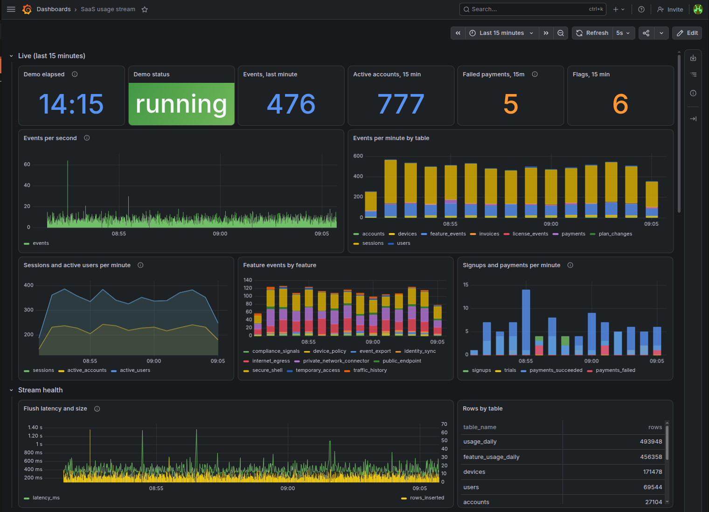
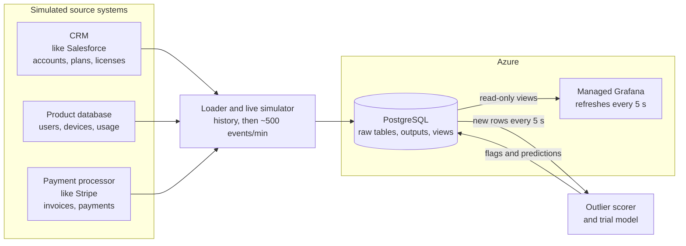
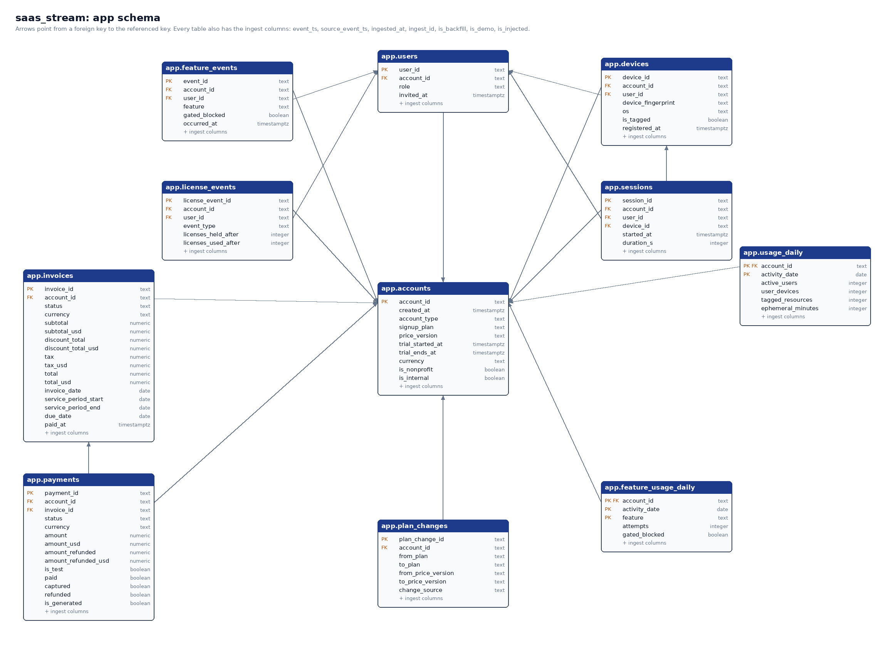
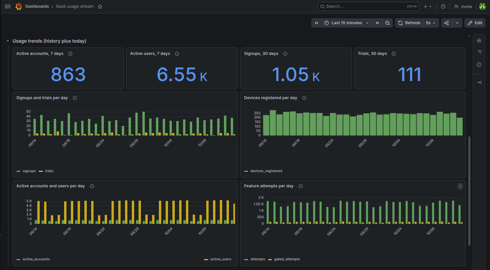
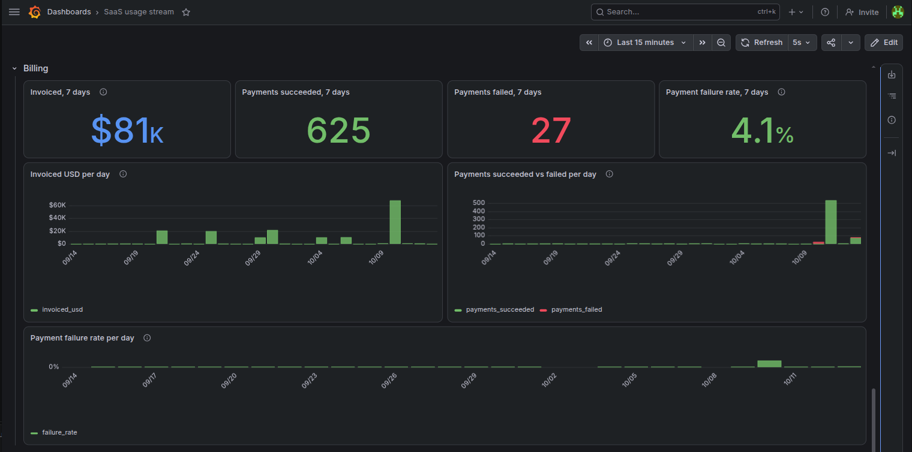
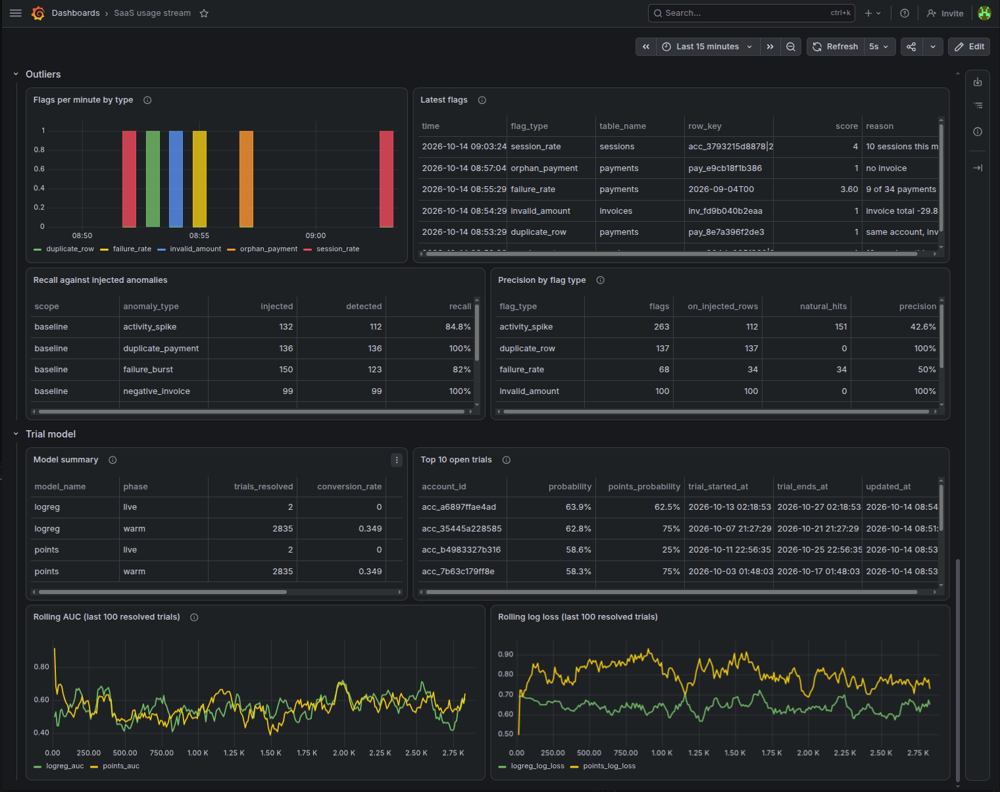
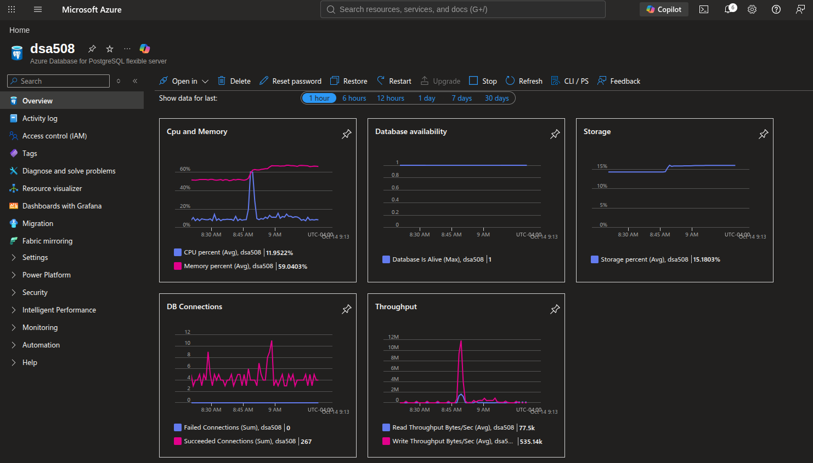

# saas-usage-stream-azure

A real-time analytics pipeline for a B2B SaaS product, built on Azure Database for PostgreSQL and Azure Managed Grafana. About 1.25 million rows of history load first. Then a live simulator streams sessions, feature events, signups, and payments at about 500 events per minute. An outlier detector flags bad data and unusual behavior within seconds, and an online model predicts which free trials will convert to paid plans.



## Results

- **Streaming:** 1,252,924 history rows across 9 tables, then about 500 live events per minute committed in one-second batches. A 42-panel Grafana dashboard reads the stream through a read-only role and refreshes every 5 seconds.
- **Outlier detection:** live anomalies are flagged about 2.5 seconds after they land. Against 517 anomalies injected into history:

  | Anomaly | Recall | Precision |
  |---|---:|---:|
  | Duplicate payment | 1.00 | 1.00 |
  | Negative invoice | 1.00 | 1.00 |
  | Failure burst | 0.82 | 0.49 |
  | Activity spike | 0.80 | 0.41 |

  Precision counts only injected anomalies as true positives, so it is a lower bound: most of the "false" failure-burst flags are the source's real monthly payment-retry runs.
- **Trial conversion:** the first evaluation reported an AUC of 0.71. An ablation showed that was label leakage: converted trials were scored slightly later, and the model learned the day count. Scoring every trial at a fixed day 7 removed the leak. The honest result is a well-calibrated model with weak ranking (holdout AUC 0.54, 95% CI 0.42 to 0.66, on 95 trials), and nearly all of its signal comes from one feature: trials whose users had used the product on a personal account convert at 52% against 30%.
- **Reproducibility:** every live take is seeded. `make demo-reset` restores the checkpoint in about 3 seconds, and the next take replays the same events, anomalies, flags, and predictions.

## Architecture



A real SaaS company keeps its data in several systems: product activity in the application database, accounts and plans in a CRM such as Salesforce, and invoices and payments in a payment processor such as Stripe. This project simulates all three. The data is shaped like those systems but generated locally, not pulled from them.

1. **Sources:** the three simulated systems supply accounts, users, devices, usage, plan changes, invoices, and payments.
2. **Ingestion:** a loader writes months of history once, then a live simulator sends individual events at about 500 per minute.
3. **Storage:** everything lands in Azure Database for PostgreSQL, which holds the raw tables, the analytics outputs, and the views the dashboard reads.
4. **Analytics:** the outlier scorer and the trial model read new rows every 5 seconds and write flags and predictions back. Each reads past its own watermark and commits outputs and watermark together, so a restart never writes twice.
5. **Dashboard:** Azure Managed Grafana reads the views through a read-only login.

The loader, simulator, scorer, and model are one local Python process that connects to Azure over TLS.

## Schema

The `accounts` table is the center of the schema: every other table links to it, activity tables also link to users and devices, and payments link to invoices (16 foreign keys).

| Table | Source system | One row is |
|---|---|---|
| accounts | CRM | a signup, with plan, trial dates, and currency |
| plan_changes | CRM | an account moving between plans, including trial outcomes |
| license_events | CRM | a paid license added, used, or released |
| users | Product database | a person invited to an account |
| devices | Product database | a device registered by a user |
| sessions | Product database | one user session on one device (live stream) |
| feature_events | Product database | one use of a product feature (live stream) |
| usage_daily | Product database | one account's activity on one day (history) |
| feature_usage_daily | Product database | one account's use of one feature on one day (history) |
| invoices | Payment processor | a bill sent to an account |
| payments | Payment processor | a card or bank payment attempt |



Two more schemas keep outputs and dashboard logic separate: `ops` holds flags, predictions, model metrics, injected-anomaly labels, and each consumer's watermark, and `dash` holds one view per Grafana panel. DDL is in [sql/ddl/schema.sql](sql/ddl/schema.sql) and views in [sql/views/dash.sql](sql/views/dash.sql); more diagrams are in [docs/ARCHITECTURE.md](docs/ARCHITECTURE.md).

## Dashboard

| | |
|---|---|
|  |  |



## Quick start

Requirements: Python 3.12, [uv](https://docs.astral.sh/uv/), and an Azure Database for PostgreSQL server you can reach.

```sh
cp .env.example .env        # fill in host, admin user, passwords; keep sslmode=require
make setup                  # install dependencies
make db-init                # create the database, schemas, tables, roles, and views
make baseline               # load history, score it, save the demo checkpoint (~3.5 min)
make demo                   # stream live events with the scorer and model; Ctrl-C stops all three
make demo-reset             # remove the take and restore the checkpoint (~3 s)
make check                  # unit tests, ruff, and the name check
```

History is shifted so it ends the day before `DEMO_DATE` (default: today). `make evaluate-outliers` and `make evaluate-model` write the results to [docs/results/](docs/results/). Import [grafana/dashboard.json](grafana/dashboard.json) into Grafana with a PostgreSQL data source that logs in as `grafana_ro`.

## Azure resources

| Resource | Configuration |
|---|---|
| Azure Database for PostgreSQL Flexible Server | Burstable B1ms (1 vCore, 2 GiB), PostgreSQL 18, 32 GiB storage, Canada Central |
| Azure Managed Grafana | Standard tier, Grafana 13, Canada Central |

Grafana reaches the server through "Allow public access from any Azure service"; the local process connects from an allowed IP over TLS. 

Server metrics over one hour: the CPU and write-throughput spike near 8:50 is the baseline load, followed by a live take with steady connections and no failed connections.

Both resources bill by the hour while they exist. Stop the server between sessions (`az postgres flexible-server stop`; storage still bills while stopped), and delete Grafana when it is not needed. The dashboard JSON and screenshots preserve it.

## Data

The data is synthetic. It comes from a separate simulation of a device-connectivity SaaS product, shaped like CRM, product, and payment-processor exports, with every ID re-keyed and every timestamp shifted. No real customer data is involved. The prepared files are committed in `data/prepared/`.

## Documentation

- [docs/REPORT.md](docs/REPORT.md): full write-up, including methods, evaluation, and limitations
- [docs/ARCHITECTURE.md](docs/ARCHITECTURE.md): data flow, a live take, consumers, and the model loop
- [docs/SPEC.md](docs/SPEC.md): design spec
- [docs/results/](docs/results/): generated outlier and model evaluations
